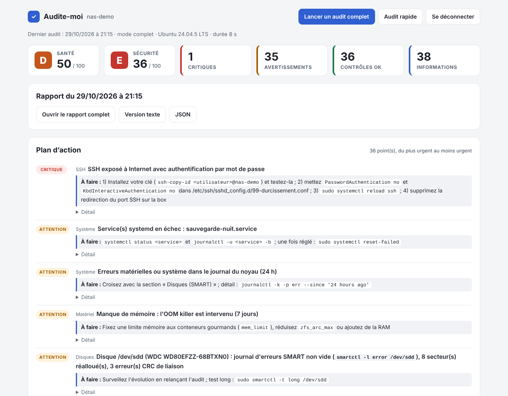
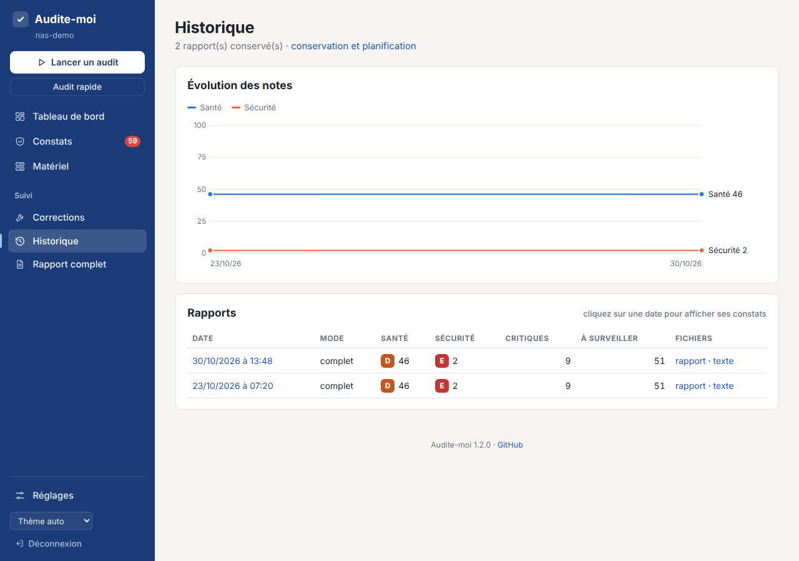
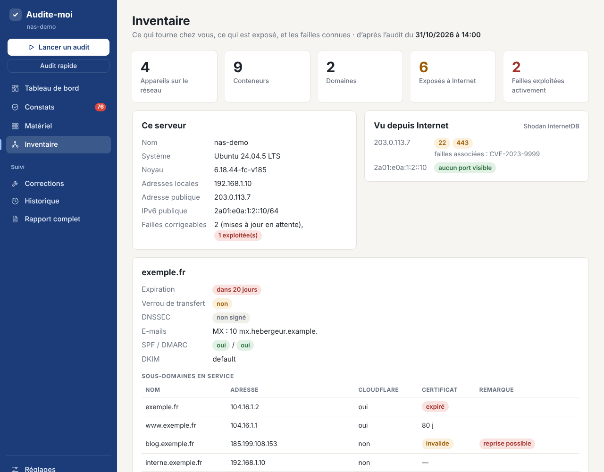
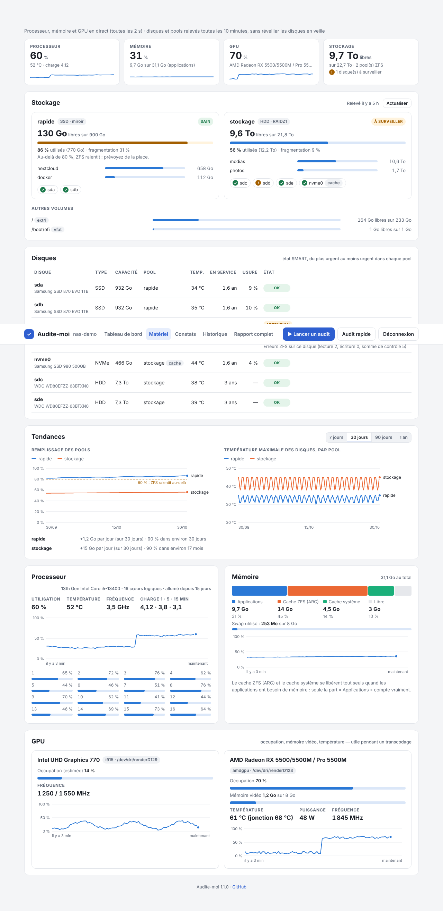
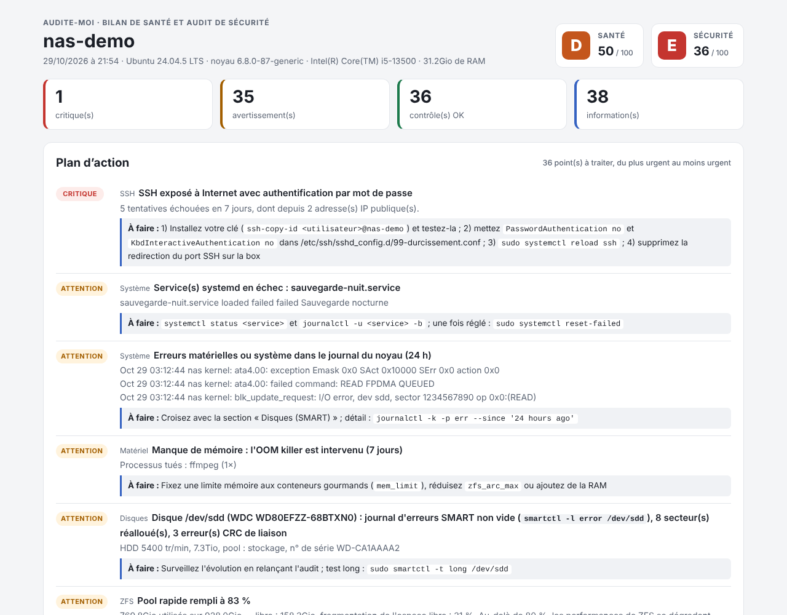
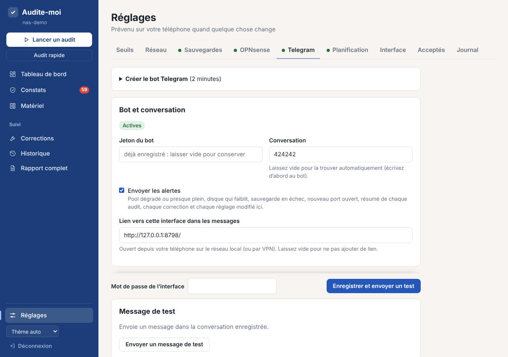
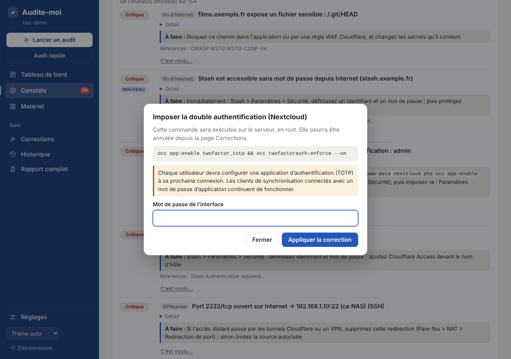

# Audite-moi

**Bilan de santé et audit de sécurité pour un NAS sous Ubuntu, son réseau et ses noms de domaine**, avec une interface web : vulnérabilités connues, pools ZFS, disques, conteneurs Docker et applications qu'ils hébergent, transcodage GPU (iGPU Intel/AMD + carte graphique AMD/NVIDIA), tunnels Cloudflare, services publiés vus depuis Internet, routeur OPNsense, réseau local, SSH, pare-feu, mises à jour, sauvegardes…

Chaque audit produit un rapport classé par priorité (**critique**, **attention**, **OK**, **info**), avec pour chaque problème la commande ou le réglage à appliquer, et deux notes sur 100 : **Santé** et **Sécurité**.



> Les captures proviennent d'un NAS simulé (le jeu d'essai des tests).

## Ce qui est vérifié

**Santé**
- **Système** : redémarrage en attente, services en échec, horloge, espace disque et inodes, erreurs du noyau (E/S, ATA, NVMe…).
- **Matériel** : charge, attente disque, mémoire (en tenant compte du cache ARC de ZFS), OOM killer, températures, ECC, onduleur (NUT / apcupsd).
- **Disques (SMART)** : état global, secteurs réalloués / en attente / irrécupérables, erreurs CRC (câble), température, usure des SSD et NVMe, auto-tests, démon smartd.
- **ZFS** : état des pools, remplissage, erreurs, dernier scrub et sa planification, TRIM des pools SSD, ZED et ses notifications, ARC, chiffrement, modules prêts pour le prochain noyau.
- **Docker** : conteneurs arrêtés en erreur, en boucle de redémarrage, *unhealthy*, tués par manque de mémoire, consommation, espace récupérable, rotation des journaux.
- **GPU et transcodage** : correspondance `/dev/dri/renderD*` ↔ GPU, pilotes (i915/xe, amdgpu, nvidia), encodage VA-API, firmware GuC/HuC, température / charge / mémoire vidéo de la carte AMD, accès réel de chaque conteneur à chaque GPU.
- **Réseau** : vitesse des liens, DNS, IPv6 publique.
- **Sauvegardes** : snapshots par pool, outils de sauvegarde (règle 3-2-1), **date de la dernière sauvegarde réussie** de chaque tâche planifiée (restic, borg, kopia, syncoid, rclone…), échecs, **copie hors du serveur** ou non ; vos propres preuves de sauvegarde (`SAUVEGARDES`, voir plus bas).
- **Tendances** : rythme de remplissage de chaque pool et date prévue des 90 % (à partir des relevés horaires).

**Sécurité**
- **Tunnels Cloudflare** : connexion du tunnel (point de contrôle `/ready`), version de cloudflared, services d'origine injoignables, noms d'hôte publiés et conteneurs ciblés, Cloudflare Access, services aussi joignables sans passer par le tunnel.
- **Vu d'Internet** : chaque nom d'hôte publié est testé comme le ferait un visiteur, en passant par Cloudflare : IP de la maison qui fuit dans le DNS (nom non proxifié, DNS dynamique), Cloudflare Access actif ou non, application qui répond **sans authentification**, version obsolète, fichiers sensibles téléchargeables (`.git`, `.env`, dossiers de données), HSTS, HTTPS forcé, TLS obsolète.
- **Applications auto-hébergées, de l'intérieur** : les applications courantes sont reconnues parmi les conteneurs Docker et prises en compte : comptes administrateurs sans double authentification, liens de partage publics sans mot de passe ni expiration, avertissements de sécurité, mode debug, protection anti-brute-force qui ne voit pas les vraies adresses IP derrière le tunnel, accès sans identifiant, mises à jour en attente.
- **Vulnérabilités connues**, classées par risque réel : failles corrigées par les mises à jour en attente (base [OSV.dev](https://osv.dev)), failles des images Docker (Trivy) et des services de chaque appareil du réseau, d'après la version détectée par nmap (base [NVD](https://nvd.nist.gov)). Chaque faille est croisée avec le catalogue [CISA KEV](https://www.cisa.gov/known-exploited-vulnerabilities-catalog) des failles **réellement exploitées**, sa probabilité d'exploitation ([EPSS](https://www.first.org/epss/)) et l'exposition (Internet, réseau local).
- **Vue depuis Internet** : ce que les scanners d'Internet voient de votre adresse publique (IPv4 et IPv6) : ports ouverts, failles associées, adresse signalée comme compromise ([Shodan InternetDB](https://internetdb.shodan.io), gratuit et sans compte).
- **Domaines** (à renseigner dans l'interface) : expiration et verrou de transfert, DNSSEC, CAA, protection contre l'usurpation des e-mails (SPF, DKIM, DMARC, MTA-STS, ou domaine sans e-mail correctement fermé), **sous-domaines** trouvés dans les journaux publics de certificats (crt.sh) : sous-domaine **pouvant être repris** (il pointe vers un service supprimé), adresse de la maison qui fuit, adresse interne publiée, certificats HTTPS expirés ou invalides.
- **Routeur OPNsense** (clé API en lecture) : redirections de ports vers le réseau local, règles WAN, **cloisonnement** (un réseau « invités », « IoT » ou « caméras » qui peut joindre les autres réseaux internes), interface d'administration exposée, UPnP, SSH du routeur, double authentification, mises à jour en attente, détection d'intrusion.
- **Réseau local** (scan `nmap` de tous les sous-réseaux, avec les versions des services) : inventaire des appareils, interfaces d'administration en HTTP non chiffré, services risqués (Telnet, FTP, RDP, VNC, API Docker, bases de données, caméras…), nouveaux appareils depuis le scan précédent.
- **Mises à jour** : correctifs de sécurité en attente, mises à jour automatiques, fin de support d'Ubuntu.
- **Comptes et SSH** : UID 0, mots de passe vides, sudo sans mot de passe, groupe docker, clés SSH, configuration de sshd, tentatives de connexion depuis Internet, fail2ban / CrowdSec.
- **Pare-feu** : UFW, ports Docker qui **contournent UFW**, bases de données exposées, Samba (SMB1, partages invités), NFS, redirections UPnP de la box.
- **Ports ouverts pour rien** : règles UFW qui ouvrent un port où **aucun service n'écoute**, redirections OPNsense vers un port vide, et — après 7 jours d'observation des connexions reçues — ports en écoute que **personne n'utilise** et ports qui reçoivent des connexions **directes depuis Internet** (hors tunnels).
- **Sécurité Docker** : conteneurs privilégiés, socket Docker monté, réseau *host*, capacités dangereuses, montages sensibles, secrets en clair, âge des images (plus strict pour les services exposés sur Internet).
- **Fichiers, noyau, journaux** : droits des fichiers sensibles, binaires SUID hors paquets, intégrité des binaires critiques (`dpkg --verify`), paramètres sysctl, AppArmor, vulnérabilités du processeur, processus suspects (mineurs, exécution depuis `/tmp`).
- **Analyses complémentaires** si installées : [Lynis](https://cisofy.com/lynis/), [Trivy](https://trivy.dev) (vulnérabilités des images), rkhunter.

Le script est en **lecture seule** : il ne modifie rien sur le serveur. Les secrets (jetons, mots de passe) sont masqués dans les rapports.

**Ce qui part vers Internet** (désactivable dans **Réglages › Vulnérabilités** et **Réglages › Domaines**) : les noms et versions des paquets à mettre à jour (OSV.dev), les versions des services du réseau (NVD), des numéros de failles (EPSS), votre adresse IP publique (Shodan InternetDB), vos noms de domaine (DNS public de Cloudflare, RDAP, crt.sh). Rien d'autre : ni rapport, ni configuration, ni nom de machine. Les réponses sont gardées en cache (`/var/lib/audite-moi/cache`, 1 à 7 jours).

**Limites assumées.** Les failles des appareils sont déduites du **numéro de version annoncé** : un correctif rétroporté par le fabricant peut ne pas le changer (faux positif possible, signalé comme tel). Sans clé API NVD, la base limite le débit : les versions sont vérifiées petit à petit d'un audit à l'autre (une clé gratuite accélère tout). La vue depuis Internet est celle de Shodan, qui peut dater de quelques jours. Le cloisonnement est vérifié **d'après les règles** d'OPNsense, pas par un essai depuis le réseau isolé (il faudrait une sonde dans ce réseau). Les identifiants par défaut des appareils ne sont **pas** essayés : cela peut bloquer des comptes ou déclencher des alarmes.

## D'où viennent les contrôles

Les contrôles reprennent des référentiels reconnus, adaptés à un NAS domestique. Chaque constat concerné affiche ses **références**, avec un lien :

| Référentiel | Utilisé pour |
|---|---|
| [CIS Ubuntu Linux 24.04 Benchmark](https://www.cisecurity.org/benchmark/ubuntu_linux) (numérotation v1.0.0) | SSH, sudo, comptes, pare-feu UFW, services, sysctl, AppArmor, droits des fichiers, auditd, mises à jour |
| [CIS Docker Benchmark](https://www.cisecurity.org/benchmark/docker) v1.7.0 | conteneurs privilégiés, socket Docker, capacités, montages sensibles, réseau *host*, ports publiés, API Docker |
| [ANSSI-BP-028 v2.0](https://cyber.gouv.fr/sites/default/files/document/fr_np_linux_configuration-v2.0.pdf) et [recommandations (Open)SSH](https://cyber.gouv.fr/sites/default/files/2014/01/NT_OpenSSH.pdf) | durcissement Linux (R8, R9, R12, R31, R39, R45, R50, R54, R56, R61, R62, R73, R79, R80…), SSH (R17, R21, R22, R28…) |
| [OWASP](https://cheatsheetseries.owasp.org/cheatsheets/Docker_Security_Cheat_Sheet.html) | sécurité Docker, fichiers sensibles exposés (WSTG-CONF-04), HSTS |
| [CISA KEV](https://www.cisa.gov/known-exploited-vulnerabilities-catalog), [FIRST EPSS](https://www.first.org/epss/) | priorité des failles connues : exploitées activement, probabilité d'exploitation |
| RFC de l'IETF | messagerie : SPF (7208), DKIM (6376), DMARC (7489), MTA-STS (8461), TLS-RPT (8460), MX nul (7505) ; DNS : DNSSEC (4033), CAA (8659) |
| [OWASP WSTG-CONF-10](https://owasp.org/www-project-web-security-testing-guide/latest/4-Web_Application_Security_Testing/02-Configuration_and_Deployment_Management_Testing/10-Test_for_Subdomain_Takeover) | sous-domaines pouvant être repris |
| Statistiques SMART de [Backblaze](https://www.backblaze.com/blog/hard-drive-smart-stats/) | attributs qui annoncent une panne (5, 187, 188, 197, 198) |
| Documentation officielle | applications auto-hébergées reconnues (double authentification, proxy de confiance, durcissement), Cloudflare (Access, proxy, versions de cloudflared), Oracle/TrueNAS (remplissage ZFS), Ubuntu, Microsoft (SMB1), US-CERT (règle 3-2-1) |

La correspondance est dans [`references.json`](references.json). **Ce n'est pas un audit de conformité** : un « A » ne signifie pas « conforme CIS ». La note et la gravité de chaque constat relèvent d'un choix pour un NAS domestique, et les seuils sont réglables (voir *Réglages*).

## Installation

```bash
git clone https://github.com/oliv2776/Audite-moi.git
cd Audite-moi
sudo ./install.sh
```

L'installateur :
1. installe les dépendances (`jq`, `python3`, `smartmontools`, `curl`, `openssl`, ainsi que `lynis`, `vainfo`, `pciutils` et `nmap` sauf avec `--minimal`) ;
2. copie le script dans `/usr/local/sbin/audite-moi` ;
3. crée l'utilisateur système `audite-moi` (sans shell ni droits root) qui fait tourner l'interface web ;
4. vous demande un mot de passe et crée un certificat HTTPS auto-signé ;
5. crée `/etc/audite-moi/audit.conf`, les réglages des contrôles réseau, des sauvegardes et des alertes (lisible par root uniquement) ;
6. active l'interface web, un audit complet automatique **chaque lundi vers 7 h 30** (modifiable dans l'interface), le relevé des disques et des connexions toutes les 10 minutes, et lance un premier audit.

Tout le reste se règle ensuite **depuis le navigateur**, page **Réglages** : alertes Telegram, routeur OPNsense, contrôles réseau, sauvegardes à vérifier, planification des audits, mot de passe (voir plus bas).

Ouvrez ensuite **`https://<ip-du-nas>:8765/`**. Le navigateur affichera un avertissement la première fois (certificat auto-signé) : acceptez-le.

Options utiles : `--port 9000`, `--ecoute 192.168.1.10`, `--sans-web` (script + audit hebdomadaire seulement), `--sans-minuteur`, `--nouveau-mot-de-passe` (si vous l'avez oublié). Le port, l'adresse d'écoute et le certificat se changent ici plutôt que dans l'interface, car une erreur couperait l'accès à la page. Relancer `sudo ./install.sh` après un `git pull` met à jour le programme en conservant configuration, planification et rapports.

## Utilisation

### Interface web

- une **barre latérale** sur toutes les pages : **Tableau de bord**, **Constats** (avec le nombre de problèmes à corriger), **Matériel**, **Inventaire**, **Corrections**, **Historique**, **Rapport complet**, **Réglages**, le choix du thème (automatique, clair ou sombre) et les boutons **Lancer un audit** (complet, quelques minutes) / **Audit rapide** (sans Lynis, Trivy, scan du réseau local ni recherche des fichiers SUID), avec le déroulement affiché en direct ; sur téléphone, elle s'ouvre avec le bouton **Menu** ;
- le **tableau de bord** résume l'essentiel : notes **Santé** / **Sécurité**, compteurs, ce qu'il faut corriger en priorité, état des alertes, de la planification, des disques et des pools, évolution des notes ;
- les notes et les compteurs sont **cliquables** : un clic n'affiche que les constats correspondants (ex. Sécurité + Critiques), un second clic annule ;
- la liste des **constats** se filtre aussi par catégorie, niveau, section ou mot-clé (ex. « ssh », « zfs ») ; par défaut elle montre ce qu'il faut corriger, du plus urgent au moins urgent, avec la correction à appliquer ;
- **ce qui a changé** depuis l'audit précédent : nombre de problèmes nouveaux (marqués « Nouveau », filtre dédié) et résolus (liste) ;
- **« C'est voulu… »** : un constat que vous assumez (avec votre raison) ne compte plus dans la note ni dans les alertes ; il reste visible, marqué « Accepté », et l'on peut revenir en arrière ;
- **corrections en un clic** pour certains problèmes (voir plus bas), avec leur journal et leur annulation (page **Corrections**) ;
- la page **Matériel** (voir ci-dessous) ;
- la page **Inventaire** : ce serveur, ce qu'Internet voit de votre adresse, vos domaines et leurs sous-domaines, chaque conteneur et chaque appareil du réseau, avec son exposition (Internet, réseau local) et ses failles connues ;
- **évolution des notes** et **historique** : un clic sur une date affiche les constats de cet ancien audit ;
- le **rapport complet** (avec un bouton « ← Tableau de bord » et les mêmes filtres cliquables), sa version texte et le JSON.





### Page « Matériel »

Un tableau de bord de l'état du serveur, mis à jour en direct :

- **Stockage** : pour chaque pool ZFS, l'espace **réellement utilisable** restant (parité déduite), le remplissage (orange au-delà de 80 %, seuil où ZFS ralentit ; rouge au-delà de 90 %), les principaux jeux de données et l'état de chaque disque membre ; les autres volumes (`/`, `/boot`…).
- **Disques** : état SMART de chaque disque (OK, à surveiller, critique) avec la raison en clair (secteurs réalloués ou en attente, erreurs CRC **en hausse**, température, usure des SSD/NVMe, erreurs ZFS), sa température et son âge. Les erreurs CRC anciennes et stables ne sont plus signalées comme un problème.
- **Tendances** sur 7 jours à 1 an : remplissage de chaque pool et température maximale des disques, avec la date prévue des 90 %.
- **Processeur** (charge totale et par cœur, température, fréquence), **mémoire** (applications, cache ZFS, cache système, swap) et **GPU** (occupation, mémoire vidéo, température, puissance, fréquence ; Intel : occupation estimée), avec l'historique des 3 dernières minutes, pratique pour suivre un transcodage.

Processeur, mémoire et GPU sont lus en direct par l'interface (sans droits particuliers). Les disques sont relevés en root par `audite-moi-mesures.timer` toutes les 10 minutes (un point par heure est gardé deux ans pour les tendances), ou tout de suite avec le bouton **Actualiser** ; les disques en veille ne sont **jamais réveillés** (leurs dernières valeurs restent affichées).



### En ligne de commande

```bash
sudo audite-moi              # audit complet ; le rapport apparaît aussi dans l'interface
sudo audite-moi --quick      # audit rapide
sudo audite-moi --help       # toutes les options
```

Sans installation, le script fonctionne aussi seul : `sudo ./audite-moi.sh` (les rapports vont alors dans `~/audite-moi/`).

Codes de sortie : `0` rien à signaler, `1` avertissements, `2` problèmes critiques, `3` erreur.



## Contrôles réseau : Internet, applications, OPNsense, réseau local

Ils se règlent dans l'interface (**Réglages › Réseau** et **Réglages › OPNsense**), ou à la main dans `/etc/audite-moi/audit.conf` :

| Réglage | Rôle |
|---|---|
| `EXTERNE=oui` | teste depuis Internet les noms d'hôte des tunnels Cloudflare (trouvés automatiquement) |
| `DOMAINES_EXTRA="a.exemple.fr b.exemple.fr"` | autres noms à tester (si les routes du tunnel ne sont pas visibles) |
| `OPNSENSE_URL`, `OPNSENSE_KEY`, `OPNSENSE_SECRET` | accès en lecture à OPNsense (voir ci-dessous) |
| `OPNSENSE_VERIFIER_TLS=non` | ne pas vérifier le certificat HTTPS du routeur (seulement s'il garde son certificat auto-signé d'origine ; vérifié par défaut) |
| `SCAN_RESEAU=oui` | scan `nmap` du réseau local lors de l'audit complet |
| `SCAN_RESEAUX="10.10.1.0/24 192.168.10.0/24"` | réseaux à scanner (par défaut : ceux d'OPNsense, sinon ceux du NAS ; 1 024 adresses au plus par réseau) |

**Test depuis Internet.** Le NAS interroge le DNS public (DNS de Cloudflare en HTTPS, pour ignorer les surcharges DNS locales) puis visite chaque nom d'hôte *via* Cloudflare, exactement comme un visiteur. Les tests sont non intrusifs : quelques requêtes de lecture (page d'accueil, page de statut ou de version de l'application, présence de fichiers sensibles). Quand l'éditeur propose un scanner officiel, il est indiqué dans le rapport.

**Les applications hébergées dans Docker** sont reconnues automatiquement parmi les conteneurs et interrogées de l'intérieur (outils d'administration et fichiers de configuration de l'application). Quand un mot de passe de base de données est nécessaire, il est transmis par l'entrée standard et n'apparaît ni dans les rapports ni dans la liste des processus.

### Créer la clé API d'OPNsense

1. **Système > Accès > Utilisateurs > +** : utilisateur `audite-moi`, cochez « Générer un mot de passe brouillé » (il ne se connectera jamais à l'interface).
2. Dans **Privilèges effectifs**, ajoutez uniquement **System: Firmware** et **Diagnostics: Backup & Restore** (selon la version : **System: Configuration: Backups**). Enregistrez.
3. Rouvrez l'utilisateur, section **Clés API**, bouton **+** : OPNsense télécharge un fichier `apikey.txt` contenant `key=` et `secret=`.
4. Dans l'interface, **Réglages › OPNsense** : adresse du routeur, clé, secret ; la connexion est testée. (En ligne de commande : `sudo ./install.sh --configurer-opnsense`.)

Le privilège de sauvegarde permet de lire **toute** la configuration du routeur (c'est elle qui contient les redirections et les règles), y compris des empreintes de mots de passe et des clés VPN : la clé est donc rangée dans `audit.conf` en `600` (root seulement) et passée à `curl` par l'entrée standard ; la configuration est analysée dans un dossier temporaire privé, supprimé à la fin, et aucun secret n'est écrit dans les rapports. Supprimez cette clé dans OPNsense si vous arrêtez de vous en servir.

### Scanner le réseau depuis le NAS ou depuis OPNsense ?

Le scan part du NAS car c'est lui qui a les outils (nmap, rapports, historique) et qu'il peut se comparer d'une semaine à l'autre : il signale les nouveaux appareils. Mais il ne voit que ce que **le NAS** a le droit de joindre : si OPNsense isole un VLAN (objets connectés, invités) du réseau du NAS, ce VLAN apparaîtra vide, ce qui est justement le signe que l'isolation fonctionne. La vue complète des règles entre sous-réseaux, elle, vient de l'audit de la configuration d'OPNsense. Les deux se complètent ; il n'est pas utile d'installer nmap sur le routeur.

## Réglages depuis l'interface

La page **Réglages** regroupe, en onglets, tout ce qui se configurait auparavant en ligne de commande ou dans `audit.conf` :

| Onglet | Ce qu'on y règle |
|---|---|
| **Seuils** | niveaux « attention » / « critique » des contrôles de santé (voir ci-dessous) |
| **Réseau** | test des services publiés depuis Internet, noms d'hôte supplémentaires, scan du réseau local et réseaux à scanner |
| **Domaines** | vos noms de domaine, sélecteurs DKIM (facultatif), recherche des sous-domaines |
| **Vulnérabilités** | recherche des failles connues, détection des versions sur le réseau, vue depuis Internet, clé API NVD (facultative) |
| **Sauvegardes** | preuves de sauvegarde à vérifier (tableau éditable, voir « Vérifier les sauvegardes ») |
| **OPNsense** | adresse, clé et secret de l'API, vérification du certificat ; test de la connexion, effacement de la clé |
| **Telegram** | jeton du bot (la conversation est trouvée toute seule), alertes activées ou non, lien vers l'interface dans les messages ; message de test, désactivation |
| **Planification** | audit automatique (chaque jour, semaine ou mois, à l'heure choisie) ou aucun ; nombre de rapports conservés |
| **Interface** | mot de passe, durée des sessions ; adresse, port et HTTPS (affichés) |
| **Acceptés** | les constats déclarés « voulus », avec leur raison, et le retour en arrière |
| **Journal** | chaque réglage du serveur modifié depuis l'interface : quoi, quand, depuis quelle adresse, résultat |



**Garde-fous.** L'interface tourne sans droits : elle ne peut pas écrire `audit.conf` (lisible par root seulement) ni modifier systemd. Elle vérifie la saisie, **redemande votre mot de passe**, puis dépose une demande que `audite-moi-configurer` (root, déclenché par `audite-moi-configurer.path`) applique : liste fermée de réglages, chaque valeur revérifiée par un format strict (jamais de guillemet, d'antislash ni de retour à la ligne), sans shell. Les secrets (jeton Telegram, clé et secret OPNsense) ne sont **jamais renvoyés** à la page : un champ vide les conserve. Chaque modification est notée dans le journal et **signalée sur Telegram** (y compris la désactivation des alertes, prévenue avec l'ancienne configuration). La planification est écrite dans une surcharge systemd (`/etc/systemd/system/audite-moi.timer.d/50-audite-moi-interface.conf`), conservée par les mises à jour.

### Seuils

L'onglet **Seuils** permet de changer les seuils à partir desquels un constat passe en « attention » ou en « critique » : températures des disques (par type), usure des SSD, secteurs défectueux, remplissage des pools et des volumes, délai entre deux scrubs, âge des snapshots et des sauvegardes, température du processeur et du GPU, pression mémoire, âge des images Docker, durée d'observation des ports, prévision de remplissage, alertes Telegram…

Chaque seuil a des bornes (une valeur absurde est refusée) et un bouton pour revenir à la valeur par défaut ; un seuil « critique » doit rester au-dessus du seuil « attention ». Les valeurs s'appliquent au prochain audit et au prochain relevé des disques ; les seuils modifiés sont rappelés dans chaque rapport. Les valeurs par défaut et les bornes sont dans [`seuils.json`](seuils.json), vos choix dans `/var/lib/audite-moi/reglages/seuils.json`.


## Alertes Telegram

Dans l'interface, **Réglages › Telegram** : créez un bot avec **@BotFather** dans Telegram (`/newbot`), collez le jeton, envoyez un message à votre bot puis enregistrez ; la conversation est trouvée automatiquement et un message de test est envoyé. Le jeton reste dans `audit.conf` (root seulement) et n'est jamais réaffiché. En ligne de commande : `sudo ./install.sh --configurer-telegram`.

Vous êtes ensuite prévenu, en quelques minutes :
- **pool** dégradé ou de nouveau en ligne, rempli à 80 / 90 / 95 %, ou plein dans moins de 30 jours au rythme actuel ;
- **disque** qui passe « à surveiller » ou « critique », erreurs CRC en hausse, disque disparu ; relevé SMART impossible depuis 30 minutes (les disques ne sont alors plus surveillés) ;
- **sauvegarde** planifiée en échec ;
- **nouveau port en écoute** sur le serveur ;
- **après chaque audit** : notes, nouveaux problèmes, problèmes résolus, nouveaux appareils sur le réseau ;
- **chaque correction** et **chaque réglage modifié** depuis l'interface (même refusé) : une action inattendue ne passe pas inaperçue.

Un même problème n'est signalé qu'une fois (puis quand il est réglé). Les constats acceptés (« c'est voulu ») ne déclenchent pas d'alerte. Décocher « Envoyer les alertes » (ou `ALERTES=non` dans `audit.conf`) coupe tout.

## Corrections en un clic

Certains constats ont un bouton **Corriger** :

| Correction | Commande | Annulation |
|---|---|---|
| Supprimer une règle UFW orpheline | `ufw delete …` | la règle est recréée |
| Redémarrage automatique d'un conteneur | `docker update --restart unless-stopped` | politique d'origine |
| Protéger un `.env` / `compose.yml` contenant des secrets | `chmod 600` | droits d'origine |
| Lancer un scrub | `zpool scrub` | `zpool scrub -s` |
| TRIM automatique d'un pool SSD | `zpool set autotrim=on` | valeur d'origine |
| Activer smartd | `systemctl enable --now smartmontools` | `disable --now` |
| Application de partage de fichiers reconnue : couper le mode debug, imposer un mot de passe sur les liens, imposer la double authentification | outil d’administration de l’application | réglage d’origine |



**Garde-fous** : la commande exacte est affichée avant confirmation, **votre mot de passe est redemandé**, et seule une correction **proposée par le dernier audit** (écrit par root) peut être demandée. L'interface web, sans droits, ne fait que déposer une demande ; `audite-moi-corriger` (root) n'exécute que les corrections de sa **liste fermée**, revérifie la cible (règle UFW existante, pool ou conteneur réel, fichier `.env`/compose ordinaire), construit lui-même la commande, sans shell. Chaque correction est journalisée avec sa sortie et peut être **annulée** ; elle est signalée sur Telegram. L'audit suivant confirme que le problème a disparu.

Ne sont **pas** automatisés, volontairement : SSH, la politique par défaut du pare-feu (risque de vous enfermer dehors), le routeur (clé API en lecture seule), les fichiers docker-compose et les mises à jour de conteneurs.

## Vérifier les sauvegardes

L'audit trouve seul les tâches planifiées par systemd (restic, borg, kopia, syncoid, rclone, rsnapshot… ou tout minuteur contenant « backup » / « sauvegarde ») : date de la dernière réussite, échec, et présence d'une destination distante (`b2:`, `s3:`, `sftp:`, `rclone:`, `user@hôte:`…).

Pour une sauvegarde qu'il ne voit pas (dans un conteneur, lancée par une autre machine…), indiquez ce qui prouve qu'elle a réussi dans **Réglages › Sauvegardes** (une ligne par sauvegarde), ou dans `audit.conf` au format `nom:type:cible:heures` :

```
SAUVEGARDES="photos-usb:zfs:usb/photos:26 cloud:unite:restic-cloud.service:26 duplicati:fichier:/mnt/backup/duplicati:48"
```

- `zfs` : date du dernier snapshot du dataset (réplication syncoid / zfs send reçue) ;
- `fichier` : fichier le plus récent du dossier (ou date du fichier) ;
- `unite` : dernière exécution réussie d'un service systemd ;
- `heures` : délai maximal avant alerte (26 h pour une sauvegarde quotidienne).

## Sécurité de l'interface web

Le rapport décrit précisément les faiblesses de votre serveur : l'interface est conçue pour rester privée.

- Le serveur web (Python, bibliothèque standard uniquement) tourne sous l'utilisateur `audite-moi`, sans droits root et dans un service systemd durci. Il ne peut **pas** exécuter de commande : il dépose seulement une demande (audit, correction, réglage) que les services root correspondants traitent, chacun avec sa liste fermée d'actions et ses vérifications.
- Mot de passe haché (PBKDF2-SHA256, 600 000 itérations), session en cookie `HttpOnly` / `SameSite=Strict`, protection CSRF, blocage persistant par adresse IP après 5 échecs en 15 minutes, maximum 256 sessions actives et 64 connexions simultanées, HTTPS par défaut, en-têtes de sécurité stricts (CSP…).
Les compteurs anti-brute-force sont conservés dans `/var/lib/audite-moi/reglages/tentatives-connexion.json` (fichier privé créé en mode `0600`) : un redémarrage du service ne réinitialise donc pas la fenêtre de blocage de 15 minutes.
- Les constats acceptés et les seuils sont enregistrés dans `/var/lib/audite-moi/reglages` (seul dossier, avec celui des demandes, où l'interface peut écrire).
- **Ne l'exposez pas sur Internet.** Si UFW est actif, l'installateur propose de l'ouvrir uniquement aux réseaux privés (tous vos sous-réseaux, pas Internet). Pour un accès à distance, passez par un VPN, ou par votre tunnel Cloudflare **derrière Cloudflare Access** (avec `noTLSVerify: true` vers l'origine, le certificat étant auto-signé).

## GPU : Intel + AMD dans un même conteneur

Avec un iGPU et une carte AMD, chaque puce a son nœud (`renderD128`, `renderD129`…) : la section « GPU et transcodage » indique lequel correspond à quel GPU, et lesquels chaque conteneur voit vraiment. Pour donner les deux à un conteneur :

```yaml
services:
  transcodage:
    devices:
      - /dev/dri:/dev/dri
    group_add:
      - "993"   # GID du groupe « render » : stat -c %g /dev/dri/renderD128
```

## Outils optionnels

| Outil | Apport | Installation |
|---|---|---|
| Lynis | ~300 tests de durcissement | `sudo apt install lynis` |
| Trivy | vulnérabilités des images Docker | [trivy.dev](https://trivy.dev) |
| rkhunter | recherche de rootkits | `sudo apt install rkhunter` |
| vainfo | profils d'encodage VA-API | `sudo apt install vainfo` |
| radeontop / intel-gpu-tools | charge instantanée du GPU | `sudo apt install radeontop intel-gpu-tools` |
| miniupnpc | redirections UPnP de la box | `sudo apt install miniupnpc` |
| nmap | scan du réseau local | `sudo apt install nmap` |
| conntrack | connexions reçues par les conteneurs Docker (si `/proc/net/nf_conntrack` est absent) | `sudo apt install conntrack` |

## Dépannage

**« Le délai d'attente est dépassé » dans le navigateur** : un pare-feu bloque le port 8765 (le plus souvent UFW sur le NAS).

```bash
sudo systemctl status audite-moi-web --no-pager       # le service doit être « active (running) »
curl -kI https://127.0.0.1:8765/connexion              # depuis le NAS : doit répondre « HTTP/1.1 200 »
sudo ufw status                                        # UFW actif sans règle pour 8765 ?
sudo ufw allow from 192.168.0.0/16 to any port 8765 proto tcp comment Audite-moi  # idem pour 10.0.0.0/8 et 172.16.0.0/12
```

`sudo ./install.sh --ouvrir-pare-feu` ouvre automatiquement le port à tous les réseaux privés (10.0.0.0/8, 172.16.0.0/12, 192.168.0.0/16) : tous les PC de la maison, quel que soit leur sous-réseau, mais pas Internet. Pensez aussi à bien taper **https://** (et non http://).

**« La connexion a échoué »** (refus immédiat) : le service ne tourne pas, voir `sudo journalctl -u audite-moi-web -n 30`.

**Pas d'alerte Telegram / « échec d'envoi » sur le tableau de bord** : `sudo python3 /usr/local/lib/audite-moi/audite-moi-mesures --test-telegram` envoie un message de test ; le journal du relevé : `journalctl -u audite-moi-mesures -n 30`.

**Une correction reste « en cours »** : `systemctl status audite-moi-corriger.path audite-moi-corriger.service` et `journalctl -u audite-moi-corriger -n 30`.

## Désinstallation

```bash
sudo ./uninstall.sh          # garde rapports et configuration
sudo ./uninstall.sh --purge  # supprime tout
```

## Tests

Les tests rejouent l'audit sur un NAS simulé (faux `zpool`, `docker`, `smartctl`, `journalctl`… dans `tests/mock/bin`), avec des réponses simulées des services publics (`tests/http_simule.py` : aucun accès réseau), et testent l'interface web :

```bash
sudo tests/run-tests.sh          # scénario simulé + interface web + shellcheck
sudo tests/run-tests.sh --reel   # + une exécution réelle (lecture seule) sur la machine
```

## Structure

```
audite-moi.sh            le script d'audit (bash)
seuils.json              seuils par défaut et bornes (modifiables dans l'interface)
references.json          référentiels associés aux constats (CIS, ANSSI, OWASP, RFC, CISA KEV…)
audite-moi-analyse.py    vulnérabilités connues, vue depuis Internet et domaines (Python, appelé par l'audit)
web/audite-moi-web.py    l'interface web (Python 3, sans dépendance)
systemd/                 services : audit (.service/.path/.timer), relevé des disques, des connexions et alertes
                         (audite-moi-mesures), corrections (audite-moi-corriger), réglages modifiés depuis
                         l'interface (audite-moi-configurer) et interface web
install.sh, uninstall.sh
tests/                   simulations, données d'exemple et tests
```
